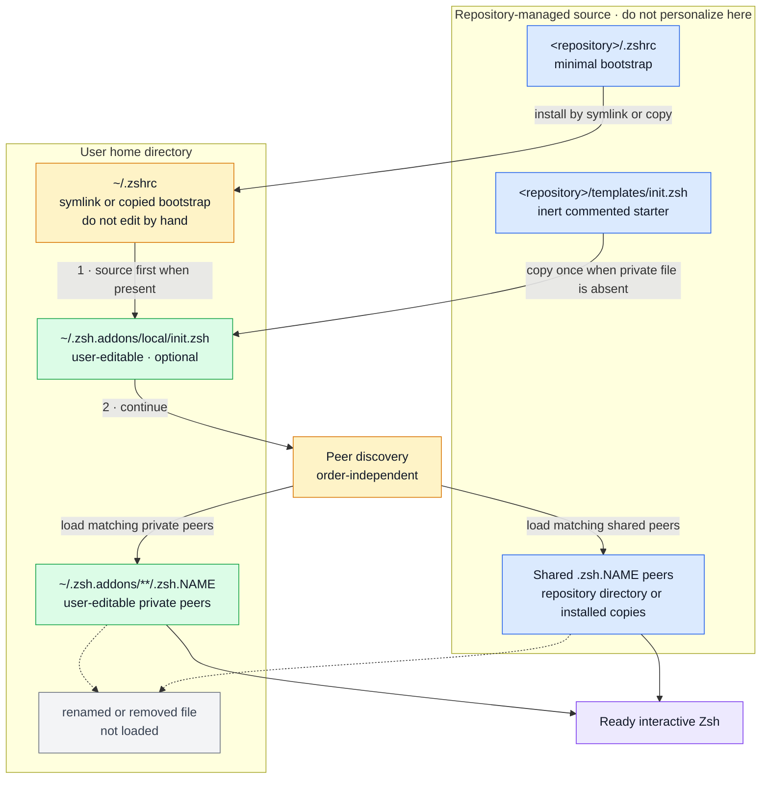

# Compozsh

A polished, self-contained Zsh setup with no frameworks, prompt themes, or
third-party plugins. It targets Zsh 5.9 or newer and stock macOS Terminal.app.

Before installing, read [Security and privacy](SECURITY.md) for the no-phone-home
boundary, the complete `sudo` and local-data inventory, and commands that let
you audit the exact commit yourself.

## Start with your next task

| What you want to do | Entry point | What happens next |
| --- | --- | --- |
| Browse a known folder | `~/`, `./`, `/` or another directory path, then Tab | Right enters a child, Left goes back, Enter inserts an editable path |
| Inspect the shell context | Enter a project or Git repository, or press Option-I | The Context lens expands for meaningful changes; Option-I pins it |
| Understand the command you are typing | Type at the prompt | The Interaction lens shows literal structure, captured context and a qualified hint |
| Recall a visited folder | Option-Tab | Filter this shell's directory stack; Enter inserts its path |
| Find a file below a folder | Path + Tab → Ctrl-F | Check the source and scope, enter a query, press Enter |
| Act on a found file | Select it, press Enter | Open, Reveal in Finder, Copy path, or Insert path |
| Switch a Git branch | `g` | Filter local branches; unmatched filters offer remote-tracking refs |
| Manage Git worktrees | `g --worktree` | Create, enter, move or remove checkouts through reviewed choices |
| Review Git changes | `g` → Ctrl-X, or `g --review` | Read working changes, commits or a revision pair in a two-pane reader |
| Build an editable command | `g --review` or `mkcd`, then Option-Return → Compose this command | Edit literal fields; Replace draft never executes |
| Learn a tool's arguments | `<tool> --help` | Read topics beside their explanations |
| Recall a command | Ctrl-R | Match fragments in any order; selection returns an editable command |
| Discover your custom tools | `compozsh` | Explore loaded public functions and their help |
| Prepare an external drive | `external-device` | Create bootable media or format a drive, with typed erase confirmation |
| Build, test or run an Xcode project | `xcode` | Pick a scheme and destination, then an action |

These tools share one full-screen layout, visible action hints and a
**Ctrl-K keyboard guide**. Escape returns or cancels. Inserting a directory
does **not** change to it: review the path, then press Enter at the prompt.
File actions are explicit and use the exact selected item.

Option-I, Option-Tab and Option-digit shortcuts need
[Option as Meta](#option-as-meta-one-time-setup). Using an AI chat alongside
your shell? See the [native tab workflow](#chat-and-shell-in-native-terminal-tabs).

## What it includes

- **Prompt:** a living prompt with an automatic or Option-I-pinned Context lens,
  a real-time Interaction lens and timestamped command receipts; exact Git
  counts and operation warnings; toolchain detection for more than 35 project
  types with package-manager, framework and container context and
  version-mismatch warnings; virtual-environment and job indicators; outcome
  receipts for slow successes and every failure
- **Editing:** live native syntax highlighting, history autosuggestions, prefix
  history search, a fuzzy `Ctrl-R` picker, shared deduplicated history,
  protection against overwriting non-empty files with `>`, and `Ctrl-X Ctrl-E`
- **Navigation and Git:** a contextual directory picker on Tab; a path + Tab
  workspace with Browse, scoped Search, Recents and safe file actions; a
  searchable branch selector; read-only Git review; a worktree workspace; a
  guarded discard
- **Tools:** a `compozsh` explorer for public functions and their help;
  external-drive formatting and verified bootable media with target-bound erase
  confirmation; a native Xcode workspace with live logs and Simulator LLDB; an
  Apple skill exporter; `cpdir`
- **Appearance:** automatic dark/light palettes, semantic Git colors, colored
  listings, completion and manual pages, a useful tab title, small aliases
- **Configuration:** an optional first-loaded `~/.zsh.addons/local/init.zsh` and
  automatically loaded, order-independent `.zsh.addons/**/.zsh.<name>` peers

The [`.zshrc`](.zshrc) file is only a tiny bootstrap. Every shared feature lives
as a native, readable peer in [`.zsh.addons`](.zsh.addons), with no framework or
plug-in manager.

## Requirements

- Zsh 5.9 or newer (current macOS releases ship with Zsh 5.9); older releases
  are deliberately unsupported
- Git, for cloning and the repository-aware prompt, navigation and tools
- A terminal with Unicode and color support; no patched font is required
- Full Xcode, only for the Xcode workspace; physical-device Run needs a device
  supported by that Xcode's `devicectl`, and the skill exporter needs Xcode 27
  or newer

```sh
zsh --version
git --version
```

## Security and privacy

Privacy, credential protection, data minimization, and user control are
top-level product goals. Features capture only the facts their visible task
needs, prefer temporary in-memory state, and keep every intentional persistent
boundary explicit.

All processing performed by Compozsh stays on the machine running Zsh.
Compozsh never transmits user or project data under any circumstance. This is a
non-negotiable product invariant, with no telemetry opt-in, debugging exception,
or future network mode. User-configured synced or network-mounted storage,
macOS clipboard synchronization, and programs you explicitly direct to
communicate—such as Git during `push`, `fetch`, `pull`, or `clone`—remain
separate trust boundaries. Compozsh does not configure those destinations or
add data, endpoints, or requests to external commands.

There is no telemetry, analytics, update check, project server or runtime
network client. Expected local state, such as history and installer recovery
backups, remains. Administrator access happens only in the two confirmed
external-media tasks and `compozsh --sudo-touch-id enable|disable`. Command
receipts show submitted commands as typed and do not redact them from
scrollback or history. [SECURITY.md](SECURITY.md) has the full data inventory,
limitations, vulnerability reporting and copy-paste audit commands.

### Touch ID for sudo

On macOS Sonoma 14 or later, a Mac with an enrolled Touch ID fingerprint can opt
`sudo` into Apple's `pam_tid` through
[Apple's update-persistent `sudo_local` interface](https://support.apple.com/en-us/109030):

```sh
compozsh --sudo-touch-id          # inspect without administrator access
compozsh --sudo-touch-id enable   # install the fixed local PAM policy
compozsh --sudo-touch-id disable  # remove the exact policy Compozsh installed
```

- The rule is `sufficient`: failed or unavailable biometrics fall through to the
  password, and it never grants sudo to an account that lacks it. The first
  authorization normally asks for your password.
- The Secure Enclave performs the match; Compozsh sees only `sudo`'s exit status.
  Touch ID authenticates you; it does not make a command safe.
- `enable` and `disable` run `sudo -v`, which can refresh sudo's cached
  timestamp (`sudo -k` invalidates it). The timeout policy is unchanged.
- Enable refuses writable or ACL-bearing policy paths and never replaces custom
  policy; it writes `/etc/pam.d/sudo_local` as `root:wheel` mode `0444`, which
  persists across macOS updates. Disable removes only an exact match.
- SSH and some multiplexed sessions fall back to the password, because
  `pam_tid` needs a local graphical session.

Get administrator approval before enabling this on a managed Mac. Compozsh never
enables it during installation, startup or updates. This mode replaces the
removed `compozsh-sudo-touch-id` command. Run `compozsh --sudo-touch-id --help`
for the full safety and recovery contract.

## Installation

The native Zsh installer validates the tracked files, shows its complete plan,
preserves existing state, and rolls back an incomplete activation. It does not
download a framework or run code from another project.

### 1. Clone into a stable location

Save the location in `repo_dir`; every later command then works from any current
directory:

```sh
repo_dir="$HOME/Projects/compozsh"
git clone https://github.com/bitbemol/compozsh.git "$repo_dir"
```

If the repository is already cloned, skip `git clone` and set `repo_dir` to its
location. Do not create, empty, or replace the clone's `.zshrc`.

### 2. Preview the recommended installation

```sh
zsh "$repo_dir/install.zsh" --symlink --dry-run
```

The plan names the active configuration base, `${ZDOTDIR:-$HOME}`, and every
action. Do not delete or truncate an existing `.zshrc`: the installer archives
it under `.zsh-backups/compozsh-<timestamp>/` without printing its contents.

### 3. Install

```sh
zsh "$repo_dir/install.zsh" --symlink
```

Review the plan and answer `y`. The installer links the active `.zshrc` to the
repository bootstrap, keeps an existing private `.zsh.addons` tree, copies
`templates/init.zsh` only when `local/init.zsh` is absent, archives any `.zshrc`
it replaces, and restores the prior state if activation fails or is interrupted
by Ctrl-C, a hangup or a termination signal; anything it cannot put back stays
in the backup, whose path it prints. Then start a new shell:

```sh
exec zsh
```

### 4. Enable Option shortcuts in Terminal

Enable **Terminal → Settings → Profiles → your profile → Keyboard → Use Option
as Meta key**; see [Option as Meta: one-time setup](#option-as-meta-one-time-setup).

### Modes and safety options

| Option | Behavior |
| --- | --- |
| `--symlink` | Recommended. Link the bootstrap to the repository; shared peers stay beside it and update with Git. |
| `--copy` | Copy the bootstrap and shared peers into a marked `~/.zsh.addons/compozsh` namespace. Private peers remain separate. |
| `--dry-run` | Validate and print the exact plan without changing the filesystem. |
| `--clean` | Archive the active `.zshrc` and complete `.zsh.addons` tree, then install a fresh configuration. Nothing is deleted. |
| `--yes` | Accept a previously reviewed plan without an interactive prompt; useful for a non-interactive terminal. |
| `--help` | Show the installation, update, and recovery guide. |

Choose one of `--symlink` or `--copy`; omitting both in an interactive terminal
opens a mode chooser. `--copy` refuses to replace an unmarked directory of the
same name. `--clean` touches only `.zshrc` and `.zsh.addons`, never `.zshenv`,
`.zprofile`, `.zlogin`, `.zlogout`, Zsh's `.zcompdump`, the repository or
exported agent skills.

## Apply changes

Open a new terminal, or reload with `exec zsh`. It starts a clean shell instead
of stacking hooks the way repeated `source ~/.zshrc` would.

## Updating

With the recommended symlink installation, pull the repository and start a
clean shell. The linked bootstrap and adjacent add-ons update together:

```sh
git -C "$repo_dir" pull
exec zsh
```

For a copied installation, pull and rerun the installer. It stages the complete
new shared namespace before replacing the marked old one:

```sh
git -C "$repo_dir" pull
zsh "$repo_dir/install.zsh" --copy
exec zsh
```

Rerunning the symlink installer is also safe. Keep repository peers unmodified;
put machine setup in `local/init.zsh` and personal features in private peers.

**Updating from 1.x?** Version 2.0.0 replaced `d` and `f` with the filesystem
workspace; see [Migration from d and f](#migration-from-d-and-f). Other renamed
commands are listed under [Self-documenting commands](#self-documenting-commands).

## macOS keyboard shortcuts

The editor uses Emacs-style navigation that works on compact Apple keyboards
without Home, End or forward-Delete:

| Key | Action |
| --- | --- |
| `Ctrl-A` / `Ctrl-E` | Beginning / end of line |
| `Ctrl-B` / `Ctrl-F` | Back / forward one character |
| `Option-B` / `Option-F` or `Option-Left` / `Option-Right` | Back / forward one word |
| `Ctrl-D` | Delete under the cursor; on an empty line, send EOF |
| `Option-Backspace` or `Ctrl-W` / `Option-D` | Delete the previous / next word |
| `Ctrl-U` / `Ctrl-K` | Delete the line / to the end of the line |
| `Ctrl-Y` / `Ctrl-_` | Restore deleted text / undo |
| `Up` / `Down` or `Ctrl-P` / `Ctrl-N` | Search history by the typed prefix |
| `Tab` | Browse a lone path or directory argument at line end; otherwise complete |
| `Shift-Tab` | Complete backward; switch panes or go Back in pickers |
| `Option-Tab` | Open Recents |
| `Ctrl-R` | Fuzzy history search |
| `Option-I` | Pin or unpin the Context lens |
| `Option-Return` | Open the [Draft inspector](#draft-inspector) |
| `Ctrl-L` | Redraw a clean screen |
| `Ctrl-X Ctrl-E` | Edit the command in `$EDITOR` |

Home, End and Fn/Globe sequences work when the terminal sends them. Command-key
shortcuts and **Ctrl-Tab** stay with Terminal and macOS
([Terminal shortcuts](https://support.apple.com/guide/terminal/keyboard-shortcuts-trmlshtcts/mac)).

### Option as Meta: one-time setup

**Meta is a modifier role**, like Control. Terminal can assign it to **Option
(⌥)** for each profile you use:

1. Open **Terminal → Settings → Profiles** and select your current profile.
2. Under **Keyboard**, enable **Use Option as Meta key**. Where separate
   left/right choices exist, **Left Option alone is enough**.
3. At the prompt, press **Option-I**: the **Context lens** pins open, and pressing
   it again unpins. Option-Tab opens **Recent directories**; Escape returns.

Compozsh never changes this preference
([Apple's keyboard settings](https://support.apple.com/guide/terminal/change-profiles-keyboard-settings-trmlkbrd/mac)),
and it takes effect without reloading the shell. Inside full-screen tools,
Option-Up/Down pages like Fn-Up/Down. **Tradeoff:** a Meta Option key may stop
typing the accents or symbols your layout assigns to it; keep the other Option
key normal if you need them.

If Option-I inserts text or Option-Tab completes like Tab, check the active
profile, which Option key you enabled and custom key mappings. Without Meta,
the Context lens still opens automatically, Recents is at **path + Tab → Ctrl-X
→ Go to · Recent directories**, and every Control-based picker command works.

## Chat and shell in native Terminal tabs

Keep an AI CLI in one tab and your working shell in another. Press **Cmd-T** for
a new tab, **Ctrl-Tab** / **Ctrl-Shift-Tab** to switch (with two tabs it
toggles, even while a full-screen view is open), and **Ctrl-Cmd-F** for full
screen. In **Terminal → Settings → General**, **New tabs open with → Same
Working Directory** and **Use ⌘-1 through ⌘-9 to switch tabs** help too.

Tabs have separate sessions, directory stacks and scrollback but share command
history. Tabs in one repository share its files, index and branch, so coordinate
edits with a running AI or build. Closing a tab can terminate its programs.

## Safe output redirection

`NO_CLOBBER` with `CLOBBER_EMPTY` lets `>` create a file or reuse an empty one,
but refuses to erase a non-empty file:

```sh
print 'replacement' > important.txt    # refused when important.txt has content
print 'replacement' >| important.txt   # intentional replacement
```

## Command-line highlighting

The command line is highlighted live by Zsh's own lexer, with no plugin or
background process. Resolution follows Zsh's rules, so aliases, functions,
builtins, commands and `AUTO_CD` directories stay distinct, and other widgets'
highlights are preserved. Buffers over 512 characters or 128 tokens stay plain
until they shrink. Names below describe the dark palette; the light palette
uses deeper shades of the same families.

| Dark-background style | Meaning |
| --- | --- |
| Bold purple | Regular alias |
| Bold peach | Suffix alias |
| Bold underlined lavender | Global alias |
| Bold sky blue | Shell function |
| Bold turquoise | Zsh builtin such as `cd` or `print` |
| Bold green | External command such as `git` or `mkdir` |
| Bold underlined azure | Existing directory |
| Bold underlined lime | Executable file used as an argument |
| Underlined pink | Symbolic link |
| Bold underlined violet | Symbolic link to a directory |
| Underlined orange | Regular file with multiple hard links |
| Underlined light gray | Regular file |
| Bold underlined coral | Socket, FIFO, device, or other special file |
| Light gray | Ordinary argument |
| Cyan | Option or flag |
| Bold gold | Reserved word |
| Underlined pale yellow | Structural delimiter |
| Yellow | Conditional operator |
| Bold orange | Arithmetic expression |
| Bold pink | Pipeline operator |
| Bold coral | Boolean operator |
| Bold gray | List or case separator |
| Bold blue | Redirection operator |
| Underlined sand | Redirection target |
| Blue | Assignment |
| Khaki | Quoted string |
| Light blue | Variable expansion |
| Purple | Command or process substitution |
| Salmon | Glob or brace expansion |
| Bold pink-red | History expansion |
| Bright cyan | Escape sequence |
| Peach | Number |
| Gray | Comment |
| Muted gray | Unaccepted history autosuggestion |

Literal paths are checked without evaluating substitutions or globs. An
unresolved command keeps the normal text color while you type, and Git
subcommands stay arguments because only Git knows their meaning.

**Light and dark palettes.** Each new shell picks a palette once. Automatic mode
reads the passive `COLORFGBG` hint and otherwise keeps the dark palette; it never
queries the terminal or the macOS appearance. Stock Terminal.app usually does
not export `COLORFGBG`, so set a light profile's scheme in the initializer:

```zsh
ZSH_COLOR_SCHEME=light  # auto (COLORFGBG hint), light, or dark
```

Syntax and prompt colors use separate public maps; override only the roles you
want in `~/.zsh.addons/local/init.zsh` (these accents suit a dark profile):

```zsh
typeset -gA ZSH_HIGHLIGHT_STYLES ZSH_PROMPT_COLORS
ZSH_HIGHLIGHT_STYLES[command]='fg=118,bold'
ZSH_HIGHLIGHT_STYLES[comment]='fg=243'
ZSH_PROMPT_COLORS[identity]=110
ZSH_PROMPT_COLORS[path]=117
```

An inherited `LSCOLORS` remains an override for BSD `ls`; `unset LSCOLORS`
before `exec zsh` to get the new scheme's colors. Defaults target 4.5:1 contrast
for meaningful text and 7:1 for primary reading on standard xterm colors, with
markers and underlines that keep meaning without color. These are measured
targets, not a guarantee for remapped colors or custom overrides; see the
[palette design evidence](investigations/palette-perception.md).

`.zsh.addons/support/` holds the shared palette, matching and UI components;
keep it installed and customize through documented settings.

## Colored command output

Color appears only where the producing tool exposes reliable semantics.
Compozsh never parses or repaints arbitrary command text, so pipes,
substitutions and redirected data stay byte-compatible.

| Output | Behavior |
| --- | --- |
| `ls`, `ll`, `la`, file completion | Native file-type colors; long-listing metadata stays neutral |
| `grep` | Matches use the shared match color on a 256-color terminal |
| Git | Native semantic colors for status, diffs, logs, branches and remote messages |
| `man` | Scoped heading, reference and search-match colors when the pager is `less` |
| Compozsh help | Heading, option, example and safety emphasis on 256-color terminals |
| `curl`, compilers, TUIs | Their native behavior; `curl` bodies are untouched |
| JSON, CSV, logs, binary data | Unchanged, because meaning cannot be inferred from bytes |

Git colors are temporary `-c color.*` palette shades for human-facing
subcommands whose stdout is a terminal. Your own `color.ui` or
`color.<command>` setting still decides whether Git colors, and explicit
options win (`git -c color.ui=never log`). With stdout piped or redirected,
Git gets your exact arguments and behaves as without Compozsh. Redirected
`grep` output stays plain; use `grep --color=always … | less -R` to keep grep
colors. Manual colors apply only to `man` and never change its pager: native
`man` still chooses it from `MANPAGER`, `MANCOLOR` and `PAGER`, falling back
to `less -s`, and the colors appear when that pager is `less`.

```zsh
typeset -gA ZSH_OUTPUT_COLORS
ZSH_OUTPUT_COLORS[success]=118
ZSH_OUTPUT_COLORS[warning]=221
ZSH_OUTPUT_COLORS[error]=203
ZSH_OUTPUT_COLORS[match]=199
```

Roles are `heading`, `accent`, `success`, `warning`, `error`, `info`, `muted`,
`match` and `text` (values 0–255). Existing `GREP_COLOR`, `GREP_COLORS`,
`LESS_TERMCAP_*` and `LS_COLORS` values keep precedence. BSD `ls` colors
listings whenever `CLICOLOR` exists, even as `0` or empty: a nonempty
`NO_COLOR` at startup, inherited or set in `~/.zsh.addons/local/init.zsh`,
keeps Compozsh from setting it, and `unset CLICOLOR` turns listing colors off
in a running shell. `NO_COLOR` or fewer than 256 colors keeps Compozsh's
completion, help, `grep` and `man` colors plain.

## History autosuggestions

As you type at the end of the line, the rest of the newest matching history
entry appears in dim gray. It is display-only: Enter runs only what you typed.

```text
❯ git sw│itch feature/native-ghost
        └─ unaccepted suggestion
```

| Key | Action |
| --- | --- |
| `Right Arrow` or `Ctrl-F` | Accept one character |
| `Option-F` or `Option-Right` | Accept through the next word |
| `Ctrl-E` | Accept everything (a first press moves a mid-line cursor to the end) |

`Ctrl-_` undoes an acceptance. Matching uses a case-sensitive prefix over the
512 most recent history events, with no subprocess or index. Suggestions stay
hidden for leading-space commands, multiline buffers and entries with control
bytes. Pressing Enter clears an unaccepted suggestion before the line reaches
scrollback, on continuation prompts too; a line interrupted with Ctrl-C stays
as painted.

```zsh
ZSH_AUTOSUGGEST_ENABLED=0
typeset -gA ZSH_HIGHLIGHT_STYLES
ZSH_HIGHLIGHT_STYLES[autosuggestion]='fg=241'
```

## Fuzzy history search

Press `Ctrl-R` and type what you remember. Fragments may be abbreviated in order
(`gtsw` finds `git switch feature/example`) and may appear in any order
(`-c swift` finds `swift build -c release`). Results are case-insensitive,
deduplicated and newest-first within these tiers:

1. Commands beginning with the literal query
2. Commands containing the literal query
3. Commands containing every literal fragment, in any order
4. Otherwise, character-ordered fuzzy matches within single command words

Existing draft text becomes the initial query; `Ctrl-U` clears it. `Ctrl-E`,
Right or Tab reads the full selected command. **Selection never executes**:
Enter puts the exact entry on the editable line, and Escape restores the
original line. `Ctrl-C` aborts.

The picker searches Zsh's loaded history in memory, which `HISTSIZE` bounds
(stock macOS keeps 2,000 entries and saves 1,000; set `HISTSIZE` and `SAVEHIST`
in the [initializer](#local-user-and-machine-settings) to change them), and
shows eight rows by default. Colors use `picker-*` roles in
`ZSH_HIGHLIGHT_STYLES`, such as `picker-query`, `picker-selected` and
`picker-match`; older `history-search-*` overrides still take precedence.

```zsh
ZSH_HISTORY_SEARCH_MAX_RESULTS=12
typeset -gA ZSH_HIGHLIGHT_STYLES
ZSH_HIGHLIGHT_STYLES[picker-selected]='fg=231,bg=24,bold'
```

### A full-screen workspace for every picker

History, directories, branches, files, the tool explorer, Git review, Xcode and
external-device tools open on the terminal's **alternate screen**, like `less`.
Your output and unfinished command are hidden while you work and restored when
the view closes, before any copy, directory change or Finder action. Terminals
without alternate-screen support keep an inline picker sized to fit below the
prompt.

Every view has a title bar, a status row, a navigation strip such as
**Results → Preview**, the results and details, a filter field, and a bottom
shortcut bar that names the real Enter action and always ends with
**`^K all keys`**. **Ctrl-K** opens the full keyboard guide for the current
view and restores your exact position when closed. These are modal keys:
after the view closes, Ctrl-K and Ctrl-D regain their shell meanings.

| Shared key | Behavior |
| --- | --- |
| Up/Down or Ctrl-P/N | Move; scroll when details have focus |
| Enter | Apply the action named in the footer |
| Option + visible digit | Apply that visible row (both filter fields empty) |
| Escape / Ctrl-G | Cancel, or go back from a secondary view |
| Ctrl-C | Abort the whole view; the command returns status 130 |
| Ctrl-U / Ctrl-W | Clear the active field / delete its last word |
| Ctrl-] | Switch between the filter and **Exclude contains** |
| Fn or Option-Up/Down, Ctrl-V/Ctrl-D | Page the focused pane |
| Tab, Ctrl-E / Ctrl-B | Switch focus between list and details |
| Ctrl-Y / Option-W | Copy the selected value and close, when available |
| Ctrl-X | Open the view's options or review menu |
| Ctrl-R | Refresh where supported; otherwise select the next result |

Plain digits always edit the filter. Typed fragments are underlined in results.
Keys a view doesn't use, such as Left/Right, Home/End or function keys in a
plain list or text field, beep and keep what you typed; they never cancel.
Resizing repaints captured results without rediscovery, and the normal screen
and scrollback are never cleared.

**Interrupted paste.** A recognized paste that pauses over one second or
exceeds 1,048,576 characters is discarded, leaving the filter unchanged. If the
terminal never finishes it, press **Escape**, then type **`[201~`** to recover.

### Excluding candidates

**Ctrl-]** reveals **Exclude contains** below the filter and switches typing
between the two. Both stay active: the filter keeps the view's normal matching,
and exclusion hides candidates containing one case-insensitive literal phrase.
Filter `swift` with exclusion `nod` keeps `new/other/data.swift` but hides
`Node.swift` and `node_modules/helper.js`. File Search compares full paths,
Browse compares child names and history compares command text; no file
contents are read. It works in every candidate list, including history, files,
branches, Git review, worktrees, help topics, Xcode and external-device views.

## Contextual directory completion

The filesystem workspace has three views: **Browse** a folder, **Search** below
it, and **Recents** for this shell's visited locations. **Ctrl-X** opens its
actions menu.

| Starting point | Gesture | Result |
| --- | --- | --- |
| A known folder | `~/`, `./` or another directory path + Tab | Browse it; Enter inserts an editable path |
| A remembered location | Option-Tab | Filter the directory stack; Enter inserts an editable path |

The selected path returns quoted to the prompt with the cursor at its end. A
lone path or Recents selection replaces the draft; a directory argument
replaces only that argument. **Selection never changes directory or runs the
command**: press Enter at the prompt (a lone path uses `AUTO_CD`). Cancelling or
copying leaves everything unchanged. For example, `vim ~/Developer` + Tab,
choosing `example/`, leaves `vim ~/Developer/example/` ready to edit.

```text
❯ ~/Projects/
  Directory browser                                    COMPOZSH
Hidden: off · child directories · 3 files · 2 shown
~ › Projects
— Results → Preview —
[1] ▸ example-app/

[2]   experiments/
  Filter folders  ›
⏎ insert · Esc cancel · ^Y copy · ↑/↓ move · ^K all keys
```

Wide terminals add a **Location** trail (from 120 columns) and a **Preview**
pane. A folder without subfolders still shows its file count and up to eight
file names, for information only.

| Browser key | What it does |
| --- | --- |
| Right / Tab | Enter the selected folder |
| Left / Shift-Tab | Go back, restoring selection and filter |
| Ctrl-O | Preview the selected (or current) folder |
| Ctrl-F | Search below the displayed folder |
| Ctrl-E / Ctrl-B | Focus the preview / the list |
| Ctrl-X | Folder actions, including **use current folder** and Recents |
| Ctrl-T | Toggle hidden folders |
| Ctrl-Y / Option-W | Copy the absolute path and close |

**Preview** lists names and types only (up to 40 entries) from the folder you
request, never file contents. Ctrl-X actions insert, change directory, copy,
open with the default app or **Reveal in Finder** (which selects without
opening); apps launch only after the screen is restored. Copying writes the
plain absolute path; over SSH it uses the clipboard of the machine running Zsh.
Browsing reads only immediate child directories, with no recursive scan or
index, though a slow mounted filesystem can still delay it.

Commands, options, file arguments, a mid-line cursor, missing parents,
operators, expansions and quoted tildes fall through to normal completion. At
most ten rows show at once, so every index is a single key:

```zsh
ZSH_DIRECTORY_PICKER_MAX_RESULTS=8
```

## Filesystem search in the path workspace

Open a folder with **path + Tab**, press **Ctrl-F**, enter fragments and press
**Return**. The scope is always the **displayed folder**, never the highlighted
child: `./` searches the current directory, `~/` your home, `/` the filesystem
root (through Spotlight by default on macOS), and `~/Projects/` that folder.
Escape returns to the same browsing position.

| Displayed folder | Default source |
| --- | --- |
| Inside a Git worktree | Git, scoped to that folder (takes precedence) |
| Exactly `~/` or `/` on macOS | Spotlight index |
| Anything else | Bounded filesystem walk |

**Ctrl-X** picks a source explicitly:

| Source | Coverage |
| --- | --- |
| Search filesystem | Breadth-first walk with hidden entries; skips `.git` metadata at any depth, unreadable folders and directory symlinks |
| Search Git files | Tracked and non-ignored untracked files, plus matching directories |
| Search Spotlight index | macOS indexed paths below the folder |

A failed or missing source is reported and **never silently replaced** by a
crawl; partial results carry a **partial** warning. Spotlight can miss excluded
or unindexed paths, so root scope is not exhaustive. Capture is synchronous, and
a first search can be slow while macOS loads index data or checks privacy
access. Typing, paging and resizing never start a deeper scan.

Matching is case-insensitive on paths, not contents; fragments may come in any
order and abbreviate characters (`net cli` matches
`Sources/Network/Client.swift`). Query text is literal. After capture the filter
refines those results, and **Ctrl-F** edits the query to capture again. An
exclusion-only filesystem or Git search is allowed; Spotlight needs filename text.

Enter or an Option-digit inserts a directory. For files and links,
**Enter → choose an action**:

| File action | Effect |
| --- | --- |
| Open with default app | Use macOS associations; this can launch an application, so open only trusted files |
| Reveal in Finder | Select the exact item in its folder (`open -R`) |
| Copy path | Copy the absolute path without a trailing newline |
| Insert path into command line | Return a quoted path to the prompt for review |
| Enter linked directory | Follow a directory symlink and change directory |

Actions run after the screen is restored. Open, Reveal in Finder, Enter linked
directory and Change directory recheck the target first; if it changed or
disappeared, one short note below the prompt says so and your draft and
directory stay as they were. Copy path and Insert path use the path as
captured, without a recheck. Selection never executes a file. Walks inspect at
most 20,000 entries, and every source keeps at most 2,000 matches:

```zsh
ZSH_FILE_SEARCH_MAX_RESULTS=10
ZSH_FILE_SEARCH_MAX_VISITED=20000
ZSH_FILE_SEARCH_MAX_CANDIDATES=2000
```

The walk and match budgets accept whole numbers from 1 to 999,999,999; any
other value uses the default.

### Migration from d and f

Version 2.0.0 removed `d` and `f`. Use **Option-Tab** instead of `d`,
`dirs -v` instead of `d --list`, and **path + Tab → Ctrl-F** instead of `f` (the
opened path sets the scope; Ctrl-X picks the source). Scripts should call
`find`, `git ls-files` or `mdfind` instead of `f --list`. Update private
aliases, then run `exec zsh`.

## Navigation stacks

The navigation peer ships five aliases (an initializer alias of the same name
wins): `..`, `...` and `....` go up one, two or three directories, `ll` is
`ls -lah` and `la` is `ls -A`.

### Recent directories

Press **Option-Tab** at the prompt, even mid-command, or use **path + Tab →
Ctrl-X → Go to · Recent directories**:

```text
Recent directories · this shell · 3 shown
Current: ~/Projects/example-app
Search ‹›
[ 0] ● example-app/       current · ~/Projects
[ 1]   api/               previous · ~/Work
[ 2]   api/               visited · ~/Personal
⏎ insert · Esc cancel · ^Y copy · ↑/↓ move · Tab details · ^K all keys
```

Filtering searches full paths. Enter or an Option-digit inserts the quoted path,
replacing the draft; **press Enter at the prompt to change directory**. Ctrl-Y
copies, Tab shows details and **Ctrl-O** browses the location in the
[folder browser](#contextual-directory-completion); a location that has since
disappeared keeps Recents open with a notice. Slot numbers are positions
on screen; run `dirs -v` for native stack indexes (`~1`, `~2` still work).
Recents never lists children, runs Git or saves a second history.

### Git branches with `g`

Inside a Git working tree, run `g` for the branch selector:

```text
Branches · local branches · recent first · 3 shown
example-app
Search ‹›
[ 0] ● feature/prompt-navigation
[ 1]   main
[ 2]   feature/runtime-line
⏎ switch · Esc cancel · ^X review · ^Y copy · ↑/↓ move · ^K all keys
```

Other arguments (`g status`, `g switch`, …) pass straight to `git`; Compozsh
reserves `--help`, `--review`, `--worktree` and `--discard-all`.

- Branches are listed current first, then by recent checkouts from Git's
  reflog, then by name. Plain digits filter (`1232` finds `bug/1232-something`).
- Enter switches with `git switch --no-guess`, so Git still refuses unsafe
  switches. Ctrl-Y copies the name instead. Tab shows the latest commit and
  upstream from a local snapshot; nothing is fetched.
- When no local branch matches, `g` offers locally stored remote-tracking refs
  such as `origin/bug/1232-something`. Enter opens **Create local branch and
  switch**, which defaults to **Back to branches**; confirming runs
  `git switch --no-guess --track=direct --create`. Nothing is reset, pulled or
  stashed.
- A branch created on the server since your last fetch will not appear: run
  `g fetch <remote>`, then reopen `g`.

Interactive `g` modes use the repository of the current folder, ignoring
inherited `GIT_DIR`, `GIT_WORK_TREE` and similar variables.

```zsh
ZSH_NAVIGATION_PICKER_MAX_RESULTS=12
```

### Git worktree workspace

Run **`g --worktree`** inside a checkout with a commit:

| Operation | Flow |
| --- | --- |
| **Create worktree…** | Choose a branch and destination, review the editable summary, then create |
| **Enter worktree…** | Fuzzy-find a registered checkout, inspect it, then enter its folder |
| **Move / rename worktree…** | Choose a linked checkout, edit its parent or name, review and move |
| **Remove worktree…** | Choose a linked checkout, check its files, then confirm removal |
| **Refresh worktrees** | Recapture the registered worktrees |

**Create** uses a **New branch** from the current commit or an **Existing local
branch** not checked out elsewhere. The suggested folder sits beside the main
checkout (`example-app-feature-search` for `feature/search`) and must not
exist; nothing is overwritten. The new worktree holds committed content only.
Choose **Create and enter** (default) or **Create and stay**.

**Move** keeps the branch and all files, on the same filesystem only. **Remove**
deletes the folder and keeps the branch and commits. It refuses the main or
current checkout, locked, missing or detached worktrees, active Git operations,
tracked changes, and untracked **or ignored** files. Removal has no Undo.

Checkout filters (including Git LFS) and submodules are refused; use Git
directly for those. Operations disable hooks, filesystem monitors, lazy fetches
and network transport, and add no force, stash or reset. Failures keep Git's
status without automatic rollback, so inspect `g worktree list` before retrying.
Worktrees persist until you remove them, even after uninstalling Compozsh.

### Read-only Git review

Run **`g` → Ctrl-X review**, or **`g --review`**:

| View | Scope |
| --- | --- |
| Working changes | The current checkout |
| Branch commits | Local history of the selected branch; Enter lists a commit's files |
| Commit files | A commit versus its first parent |
| Compare branches or commits | Two local branches, tags or commit IDs |
| Change atlas | Working changes grouped by folder |

Review has no staging, discard, commit, checkout or clipboard actions. Escape
goes back through files → commits → branches, keeping each list's position.

**Comparing.** **Compare** starts at the highlighted branch; **Against** starts
unset. Type a name and press Enter to pick the best match, or choose **Enter
branch or commit…** for a literal name or hash. **All differences** (default)
compares committed content; **Changes since common ancestor** shows only what
changed toward Compare since the histories diverged. Git does not record which
branch another came from, so choose the baseline yourself. Working-tree edits
are excluded. For a known pair (old → new, so `g --review A B` compares B
against A):

```sh
g --review release/next feature/search
g --review v1.0.0 v1.1.0
g --review a1b2c3d e4f5a6b
g --review --merge-base release/next feature/search
```

Endpoints may be branch, tag or remote-tracking names, `HEAD`, or commit IDs
(at least four hex characters). They resolve to full IDs, so **Ctrl-R** rereads
the same commits. Use plain `git diff` for ranges and paths. Nothing is fetched.

**Reading files.** Review starts in **All files**; moving onto a file shows its
diff, **Right/Tab** focuses the reader and **Left** returns. **Ctrl-X** opens
**View options**: **All files**, **Tree** (folders with a **Folder summary**),
**Jump to ancestor** and **Change atlas**, a per-folder map of change counts.
**Focused diff** is the default, with three context lines and old/new line
numbers; **Right** expands to full-file context and **Left** collapses. Green
`+` rows are additions and red `-` rows removals. Each file keeps its reading
position, and untracked text files preview as additions. Typing filters paths;
Ctrl-] excludes.

**Working changes refreshes automatically.** **Ctrl-A** pauses or resumes and
**Ctrl-R** refreshes now, keeping your filter, file and reading position. If
the file you are reading leaves the results, the reader keeps it and shows
**update ready** until you return to the list. A failed refresh keeps the last
snapshot and pauses until Ctrl-R. To start paused:

```zsh
ZSH_GIT_REVIEW_AUTO_REFRESH=0
```

**Code highlighting.** The optional `.zsh.git-syntax` peer colors Swift, Zsh,
shell, JSON and Python with Apple's `/usr/bin/vim`. Your Vim configuration,
plugins, swap and history are disabled, and source never reaches a file. It is
lexical coloring of captured fragments with a plain fallback. One private Vim
lives only while review is open. Colors are the `review-*` roles in
`ZSH_HIGHLIGHT_STYLES`, such as `review-added`, `review-removed` and
`review-keyword`.

**Limits.** Captures keep at most 256 KiB, 1,000 changes or 200 commits;
documents keep 10,000 lines. Binary files, conflicts and symlinks show notices,
submodules are excluded, and renames appear as a deletion plus an addition.
These limit output, not time, so huge worktrees can still be slow. Review
disables external diff, text conversion, filters, hooks and network transport,
so filtered files can differ from your configured `git diff`. Review and the
`g` branch picker never verify commit signatures, so no configured verifier
(such as `gpg.program`) runs.

`g --review` needs an interactive terminal; use `git diff A B` for plain output.

## Discard all Git changes

`g --discard-all` is a guarded “Discard All Changes”. It previews every affected
path and needs a typed `y`; an empty Return or Escape cancels:

```sh
g --discard-all
```

It deletes untracked files under the reviewed ignore rules and restores tracked
files to `HEAD`, keeping ignored files, stashes, commits, submodule contents and
nested repositories. It refuses without a commit, during a merge, rebase,
cherry-pick, revert or bisect, or with an index lock, and it stops if anything
changed after the preview. Filters, hooks and submodule recursion are disabled.
Leftover changes are reported with status 1, and completed cleanup is not
rolled back. **Uncommitted work cannot be recovered**; use
`git stash --include-untracked` when you might need it. This replaces the
removed `git-discard-all`.

## Living prompt

Compozsh keeps one active prompt that moves through three moments:

- **Context lens** orients you when shell or project context changes.
- **Interaction lens** reacts in place to the command you are typing.
- **Transcript** collapses the prompt to one quiet timestamped line on Return.

These are prompt repaints, not full-screen views or a background monitor.

The **Context lens** opens on the first prompt in a project or Git repository,
and again when the project root, Git branch, Python or non-base Conda
environment, Git operation or conflict state, or runtime attention state
changes. Ordinary staged, modified, untracked, stash, ahead, and behind count
changes still update the Git summary, but do not reopen the lens by themselves.
Typing switches to the Interaction lens. There is no timer or polling loop.
**Change directory** or **Enter linked directory** in the path workspace or
Recents refreshes the folder, Git and toolchain facts and the tab title at
once, keeping your draft.
**Option-I** pins the lens while you edit; accepting a command clears the pin.
Option-I needs [Option as Meta](#option-as-meta-one-time-setup); automatic
triggers do not.

### Interaction lens

With an empty buffer the lens shows `READY`, where `LAST` is the most recent
outcome:

```text
╭─ READY
│  PROJECT          compozsh
│  PATH             ~/Developer/Remote/compozsh
│  GIT              main !3
│  TOOLCHAIN        zsh 5.9
│  LAST             ✓ 84ms
╰─ ❯
```

As you type, it reshapes before anything runs:

```text
╭─ GIT
│  OPERATION TEXT   status
│  ACTION           likely inspect working tree
│  BRANCH           main
│  PROJECT          compozsh
╰─ ❯ git status --short
```

| Header | What made it relevant |
| --- | --- |
| `READY` / `COMMENT` | An empty buffer / an interactive comment |
| `RUN` | A general command |
| `GIT` | A `git` operation or Compozsh's `g` forms |
| `NAVIGATE` | `cd`, `pushd`, `j`, `mkcd`, or a lone directory with `AUTO_CD` |
| `SEARCH` | `rg`, `grep`, `find`, `mdfind` and similar |
| `BUILD` / `TEST` | A recognized project build or test form |
| `ENVIRONMENT` | An assignment or environment-changing command |
| `REMOTE` | `ssh`, `scp`, `rsync`, `curl`, `wget` and similar |
| `PIPELINE` / `CHAIN` | Stages joined by `\|` or `\|&` / steps joined by `&&`, `\|\|`, `;` or `&` |
| `REDIRECT` | Output, input, descriptor or resource redirection |
| `CAUTION` | One of a few high-confidence caution-worthy forms |

Rows ending in `TEXT` quote the literal buffer, never evaluated or checked;
other rows reuse facts captured before the prompt. An inferred `ACTION` uses
qualifiers such as `likely`. `REMOTE` does not mean a connection exists, and
`CAUTION` is not a safety scanner: it never blocks Return, and a calm lens does
not prove a command safe.

Commands with a local manual page show its NAME line as `ABOUT`:

```text
╭─ RUN
│  COMMAND TEXT     ls
│  ARGUMENT TEXT    -la
│  ABOUT            list directory contents
│  SOURCE           Local manual · ls(1)
╰─ ❯ ls -la
```

Compozsh commands reuse their same-source help descriptions: a help-derived
`ACTION` names documented intent, such as read-only review for `g --review`,
with `SOURCE Compozsh help · command`. Documented intent is not a validation of
your command. Aliases show their current definition in an `EXPANSION` row
(up to 240 characters, never evaluated), which can display sensitive alias text.

While you edit, the lens launches no process, reads no file and makes no
network request. `NAME=value` values are never copied into it (they remain in
the buffer, transcript and history), and prompt escapes keep editor text from
being evaluated by `PROMPT_SUBST`.

The optional `.zsh.manual` peer gathers manual summaries in the background at
the first prompt, reading manual files directly from `MANPATH`, folders next to
`PATH` entries, `/usr/share/man`, Apple's selected SDK and toolchains and
common Homebrew locations. It never runs `man` or the documented command.
Changes to `PATH`, `MANPATH`, locale or developer selection refresh it at the
next prompt.

### Transcript and receipts

Accepting a command collapses the lens into a receipt:

```text
14:26 › swift build
```

An empty Return leaves the same receipt with nothing after `›`. Every failure
and every success taking at least two seconds then gets an outcome receipt:

```text
✓ 2.3s
× exit 1
× exit 1 · 2.3s
```

These are a slow success, a fast failure and a slow failure; fast successes add
nothing. Receipts never change output, exit status or history.

### Git legend

| Mark | Meaning |
| --- | --- |
| `✓` | clean working tree |
| `+2` / `!3` / `?1` | staged / modified / untracked files |
| `x1` | conflicted file |
| `≡2` | stashes |
| `⇡3` / `⇣1` | commits ahead of / behind the upstream |
| `⚡rebase` | an in-progress Git operation |

Green means clean, yellow local changes, cyan behind, magenta detached, and red
conflicts or an in-progress operation.

### Project and runtime context

Inside a recognized project, the Context lens separates location, Git,
toolchain, environment, jobs and session into rows that fit the window:

```text
╭─ CONTEXT · entered project                         Option-I pin
│  PROJECT   web-app
│  PATH      ~/Projects/web-app
│  GIT       main ✓ · tracks origin/main
│  TOOLCHAIN node 24.5.0 · pnpm · next · workspace · docker
│  SESSION   user@host · zsh 5.9
╰─
❯
```

User and host appear only in `SESSION`. Long values abbreviate with `…` and
return when the window widens; resizing reruns no detection. Detection walks up
from the current directory and covers:

- Native and systems: C/C++, Objective-C, Assembly, Rust, Go, Zig, Fortran
- Apple, web and scripting: Swift, Node.js, Deno, TypeScript, PHP, Ruby, Perl,
  Lua, Bash, PowerShell, Python
- JVM and .NET: Java, Kotlin, Scala, Groovy, C#, F#, Visual Basic
- Functional and BEAM: Haskell, OCaml, Scheme, Racket, Common Lisp, Elixir,
  Erlang, Gleam
- Scientific, game and infrastructure: R, Julia, Dart, Godot/GDScript,
  Terraform/OpenTofu

It also labels build tools, package managers, frameworks and environments it
finds, such as CMake, Bazel, SwiftPM, CocoaPods, Tuist, npm, pnpm, Bun, Next.js,
Vite, uv, Poetry, Conda, Gradle, Cargo, Helm, Pulumi, Docker, Dev Containers,
Nix and mise. Labels describe project files, not installed tools. Runtimes
resolve from your `PATH`; the prompt never runs a repository's
`node_modules`, build output or wrapper scripts.

**Version advisories** compare a project's request with the installed version:

```text
⚠ swift wants 6.3.2 · using 6.4 — newer
⚠ ruby wants 3.3.2 · using 3.2.4 — older
⚠ go requires ≥ 1.24 · using 1.23.9 — older
⚠ python requires >=3.10,<3.14 · using 3.14 — outside range
```

Older pins use the `danger` color and newer pins `warning`; matching pins and
satisfied minimums add nothing. Supported sources, in priority order:

- Dedicated files: Node `.nvmrc` then `.node-version`, and `.<tool>-version`
  files for Python, Swift, Ruby, Java, TypeScript, Deno, PHP, Bash,
  PowerShell, Kotlin, Lua, R (`.R-version`), Zig, Godot, Terraform, Julia,
  Perl, Fortran, OCaml, Scala, Erlang, Gleam, Groovy, Haskell (`.ghc-version`),
  .NET/F#/Visual Basic (`.dotnet-version`), Elixir and Dart.
- Rust `rust-toolchain` before `rust-toolchain.toml` (plain selectors and a
  literal `[toolchain] channel`; named channels, dates and target-qualified
  selectors are unverified).
- `.tool-versions` as a fallback by tool name; multiple alternatives are
  unverified.
- Without a selection file: Go's `go` line from root `go.work` then `go.mod`,
  Swift's first-line `swift-tools-version`, literal `[package] rust-version` in
  `Cargo.toml` (all minimums), and literal `[project] requires-python` in
  `pyproject.toml` (a range).

Numeric pins match by prefix (`3.12` accepts `3.12.x`); comparison uses up to
four numeric components, and Python ranges support up to eight `>=`, `>`,
`<=`, `<`, `==`, `!=` comparisons. Other operators, prereleases and vendor
suffixes show as `unverified`, never an invented order. The readers cover small
literal declarations only: `package.json` engines, `global.json` roll-forward,
Cargo dependency ranges, Haskell resolvers, CMake standards and Terraform
ranges are not interpreted, and build-tool markers are identification, not
version checks. Files over the read budgets (1 MiB per file; 64 KiB, 256 lines
and 4 KiB per line for parsing) are unverified, as are TOML multiline or
escaped strings and duplicate keys. Components have at most eight digits and
missing ones count as zero; Java quote and Ruby patchlevel decorations are
normalized, and a numeric Fortran request is compared only for GFortran. No
project file is evaluated and no toolchain is installed, activated or changed.

Installed runtime versions, the active manual catalog and same-source help
descriptions are cached in this shell for prompt speed. After installing or
upgrading a tool without opening a new shell, refresh them with:

```sh
compozsh --refresh
```

Context triggers and lens kinds are fixed; colors and project extensions are
public.

### Disposable system caches

On macOS, one optional cache at
`${ZDOTDIR:-$HOME}/.zsh.addons/support/cache/.zsh.manual.cache` speeds up
manual summaries:

- It holds only public NAME descriptions from Apple's protected
  `/usr/share/man`, plus a freshness key. Custom, third-party, Xcode and SDK
  manuals stay in memory.
- No user or project data, private paths or fingerprints of them are stored.
- OS or locale changes invalidate it; a missing or corrupt cache falls back to
  full uncached behavior.
- `compozsh --refresh` recaptures at the next prompt, replaces the cache for new
  windows, and also invalidates the same-source help descriptions snapshot.
- Deleting the `support/cache` directory is always safe; it is recreated when
  needed.

Separately, Zsh's stock `compinit` keeps its completion dump at
`${ZDOTDIR:-$HOME}/.zcompdump`. It copies the first line of each `fpath`
completion file, normally function and command names and including those from
your own `fpath` entries, but never `fpath` directory paths, history or project
data. Zsh rewrites it when it is missing, when the number of completion files
in `fpath` changes or when Zsh is updated. Its mode follows your umask, and
because new shells run it as code, it should not be writable by group or
other. Deleting it loses nothing; the next new shell recreates it.

See [SECURITY.md](SECURITY.md), the [caching contract](engineering/caching.md)
and the measured [startup results](investigations/terminal-startup-latency.md).

### Adding another language locally

Two extension points can live in a private peer such as
`~/.zsh.addons/.zsh.project-v`:

```sh
typeset -ga PROMPT_PROJECT_MARKERS PROMPT_PROJECT_CONTEXT_FUNCTIONS
PROMPT_PROJECT_MARKERS+=(v.mod)

v_prompt_context() {
  [[ -f "$1/v.mod" ]] || return

  local version
  version=$(v version 2>/dev/null) || version='not-installed'
  prompt_add_project_segment "v ${version}" "${ZSH_PROMPT_COLORS[tool]}"
}

PROMPT_PROJECT_CONTEXT_FUNCTIONS+=(v_prompt_context)
```

Markers teach the project-root search a new manifest, and each context function
receives the root path. Context functions run at each prompt and again right
after a workspace's Change directory or Enter linked directory action, while
your draft is still being edited, so keep them quick and silent.
`prompt_add_project_segment text [color]` escapes the
text; the color is a 0–255 index or a basic Zsh color name.

## Draft inspector

With [Option as Meta](#option-as-meta-one-time-setup), press **Option-Return**
on any draft. Ordinary Return still submits normally.

- **Read this draft** opens a reader with line filtering.
- **Review this working tree** opens read-only Git review for the current folder.
- **Explore tool help** opens the tool catalog.
- **Compose this command…** appears for simple `g --review` and `mkcd` drafts.
- **Choose a path here** opens Files; a selected path replaces the draft.
- **Recall a command** opens History.
- **Keep editing**, or Escape, returns to the exact draft and cursor.

The inspector never evaluates or runs the draft. Try it: type `git status`,
press Option-Return, read the draft, go Back, open review, and go Back twice;
you are at the same draft with nothing submitted.

## Command composer

Type `g --review`, then **Option-Return → Compose this command…**, or choose
**Compose example…** in `g --help`. Edit **Comparison**, **Against** and
**Compare** while the right panel shows the literal command. Revision fields
open the local ref chooser and pin choices to full commit IDs. The template
starts with editable `main` and `HEAD` placeholders.

For `mkcd`, edit **Directory**. Field text is shell-quoted, never evaluated, so
`~` and `$HOME` stay literal; enter absolute or `./relative` paths.

**Replace draft → keep editing** is the only step that changes anything: it
puts the generated command in the editor without pressing Return. Escape keeps
the original draft. Other commands are never guessed into forms.

## Built-in tools

### Self-documenting commands

Every public command supports `--help`. The complete shipped command surface:

```sh
mkcd --help
cpdir --help
g --help
g --discard-all --help
compozsh --help
compozsh --refresh --help
compozsh --sudo-touch-id --help
external-device --help
external-device --flash --help
external-device --format --help
xcode --help
xcode --export-skills --help
```

Earlier names were removed with no aliases:

| Earlier entry | Current entry |
| --- | --- |
| `git-discard-all` | `g --discard-all` |
| `flash-usb [media]` | `external-device --flash [media]` |
| `format-external-device` | `external-device --format` |
| `update-xcode-skills` | `xcode --export-skills` |
| `prompt-refresh` | `compozsh --refresh` |

Help never changes directory, copies, scans projects, changes files, uses the
network or needs optional tools, so `--help` is safe anywhere. Wrappers such as
`grep` and `man` keep the system command's help.

### Help as a workspace

In a supported terminal, `--help` opens a documentation workspace: **Overview**
plus arguments, modes, safety notes and examples on the left, with the selected
topic explained on the right. Type to filter, Enter for a full-width reader,
Escape to return. For `g` and `mkcd`, **Compose example…** opens the
[command composer](#command-composer). Pipes and `NO_COLOR` print complete
plain text:

```zsh
g --help                   # Interactive topics and explanation.
NO_COLOR=1 g --help        # Complete plain text for this invocation.
g --help | cat             # Complete printable text.
```

Run `compozsh` for a fuzzy catalog of every loaded public function with its
help beside it; Enter opens that help. `compozsh --list` and `compozsh help g`
print instead. Functions from your initializer and private peers appear
automatically, and names starting with `_` stay hidden. The catalog never runs a
function to get help: a command documents itself through a static
`_compozsh_help_<command>` companion in the same file, and functions without one
show `no help`.

```zsh
ZSH_TOOL_PICKER_MAX_RESULTS=12
```

### External-device tasks

Run `external-device` to choose **Create bootable media** or **Format a drive**.
Opening the chooser reads no disks and selects nothing. Direct modes skip it:

```sh
external-device --flash [media]
external-device --format
```

`[media]` is an optional path; quote paths with spaces. Both tasks need an
interactive terminal and share these safety rules:

- Only attached **whole external physical disks** are offered; internal,
  virtual, read-only and partition devices are excluded. Rows show the name,
  capacity, protocol and exact `/dev/diskN`.
- **Ctrl-R** recaptures devices. A drive macOS ejected can stay plugged in yet
  invisible: reconnect it, then press Ctrl-R.
- Erasing requires the typed phrase `ERASE diskN` and administrator
  authorization. The disk's identity is rechecked before authorization and
  again immediately before the effect.
- Erasing destroys all data on the whole disk and cannot be undone.

**Formatting** has three steps: choose a **drive**; choose a **format** from
everything `diskutil listFilesystems` offers on this Mac (formats whose size
bounds exclude the disk stay visible but unavailable); and keep the default
name **External** or enter one. Compozsh then runs the following command, with
Apple's output visible:

```sh
diskutil eraseDisk <personality> <volume-name> /dev/diskN
```

A failure partway can leave the old layout already gone.

### Bootable external-media workspace

```sh
external-device --flash
external-device --flash ~/Downloads/Fedora-Silverblue.iso
external-device --flash "/Applications/Install macOS Tahoe.app"
```

The workspace follows **Step 1 Media → Step 2 External drive → Step 3 Flash**.

**Step 1 · Media** lists `.iso` and `.img` files found by Spotlight under `~/`
and directly in the current folder and `~/Downloads`, plus complete **Install
macOS** apps, newest first. Nothing is selected for you. **Ctrl-R** picks up a
download that just finished. **Custom path to media…** browses from `~/` or
accepts a pasted or dropped Finder item, and you can also drag a file after
`external-device --flash `. Dropped text is used as a path, never evaluated.
Names containing `x86_64`/`amd64` or `arm64`/`aarch64` show **x86-64** or
**ARM64**; the image must suit the hardware that will boot it.

- Regular `.img` and non-Windows `.iso` files use the raw writer.
- A complete `Install macOS <name>.app` uses Apple's `createinstallmedia` only
  after `codesign` confirms Apple's signature on the app and on that tool; a
  copy whose signature no longer validates, such as an older installer with an
  expired certificate, is refused. Open a downloaded `.dmg` or `.pkg` first so
  it installs the full app ([Apple's guide](https://support.apple.com/101578)).
- **Windows Setup media is refused** before any drive is chosen: portable setup
  media needs FAT32, current images can contain an `install.wim` too large for
  it, and stock macOS has no supported way to split it
  (see Microsoft's [Windows USB procedure](https://learn.microsoft.com/en-us/windows-hardware/manufacture/desktop/install-windows-from-a-usb-flash-drive?view=windows-11)).
  Nothing is written.

**Step 2 · External drive** lists eligible USB, SSD and Thunderbolt disks,
excluding undersized disks and the disk holding the image.

**Step 3 · Flash** defaults to **Start flash & verify**, and also offers **Flash
without verification** and **Add image checksum…** (SHA-256 or SHA-512). A
checksum mismatch cannot start flashing; without one the screen says **Image
integrity · Not verified · no checksum provided**.

Choosing another image clears the checksum. After `ERASE diskN` and `sudo`,
Compozsh rechecks the image and disk, clears stale partition data beyond the
image, writes it with Apple's `dd` to `/dev/rdiskN`, then reads back and
compares every byte; a supplied checksum is verified again after writing. A
live screen shows progress. The disk is ejected after success (and an eject is
attempted after failure), and a final screen reports bytes written, duration,
integrity and whether the drive is safe to remove. A failed write or installer
run can leave the disk unusable or partly prepared; rerun the workflow or erase
it in Disk Utility before reuse.

### Native Xcode workspace

Run `xcode` anywhere inside an Xcode project. Compozsh walks upward to the
nearest folder with a `.xcworkspace` or `.xcodeproj` and asks Xcode for shared
schemes and destinations. Choose **Scheme** and **Destination**, then **Build &
Run**, **Rebuild & Run**, **Build**, **Rebuild**, **Test**, **Rebuild & Test**,
**Analyze** or **Clean**. The Rebuild actions run `clean build` or `clean test`
for that exact scheme and destination when a product seems stale. The scheme
supplies all build settings.

- **My Mac** launches a new instance of the built app; command-line products run
  in the terminal with their exit status.
- **Physical devices** install and launch through Xcode's `devicectl`. Pairing,
  Developer Mode and signing must already be set up in Xcode; Compozsh changes
  none of them. Installation is not rolled back if launch fails.
- **Simulator** boots the exact simulator and opens it in Device Hub or the
  Simulator app. If one is already running with a different architecture, shut
  it down and retry.
- If the build reports several runnable products, **Run product** asks which
  to launch. Run reads build settings for schemes of up to about 100 targets
  (5 MiB, or `ZSH_XCODE_CAPTURE_MAX_BYTES` when larger); a larger scheme stops
  with that guidance.

**Logs and LLDB.** Simulator and device runs open **Xcode / Logs**, a live reader
of the app's output (and, on Simulator, its unified logs). Scroll up to pause,
type to filter, and press Enter for options: copy all or filtered logs (also
Ctrl-Y), show **Errors and faults**, or follow latest. Escape returns to
**Xcode / Run** to stop the app or, on Simulator, **Enter LLDB**, which attaches
after rechecking the process identity without loading `.lldbinit`. Logs keep up
to 32 KiB and 200 lines in memory, and no log file persists. Compozsh never
enables private-data logging, but logs and copied text can still contain
sensitive app data.

**Build actions run project code**, including build scripts, plugins, macros
and tests, so review an unfamiliar repository first. Discovery is read-only,
with automatic package resolution disabled and output bounded by
`ZSH_XCODE_CAPTURE_MAX_BYTES` (262,144 bytes by default). Choose **Refresh
destinations** after connecting devices. If a rebuild still runs old behavior,
check target membership and dependencies in Xcode.

**Test results.** After a test action, the dashboard shows totals, or up to 20
failed tests and build errors with Xcode's reasons and source locations. When
`pbcopy` is available, **Copy report and done** copies a plain-text report built
only from those results; over SSH it goes to the clipboard of the machine
running Zsh. The temporary `.xcresult` bundle is removed before results appear.

Other arguments pass straight to `xcodebuild`:

```sh
xcode -version
xcode -showBuildSettings -scheme App
```

In a noninteractive terminal, bare `xcode` runs `xcodebuild -list`. Full Xcode
must be selected with `xcode-select`; the Command Line Tools package is not
enough.

### Export Apple-authored Xcode skills

Xcode 27 ships Apple-authored agent skills that external coding agents may not
find on their own ([release notes](https://developer.apple.com/documentation/xcode-release-notes/xcode-27-release-notes)):

```sh
xcode --export-skills
```

It detects coding agents installed locally and stops if none is found. In an
interactive terminal it first shows the planned destinations; after you
confirm, it exports the selected Xcode's skills once and copies them to each
detected agent:

| Agent | Detected installation | Destination |
| --- | --- | --- |
| Codex | `codex`, `ChatGPT.app`, or `Codex.app` | `~/.agents/skills/` and Xcode's Codex directory |
| Claude Code | `claude` or `Claude.app` | `~/.claude/skills/` |
| Gemini CLI | `gemini` | `~/.agents/skills/` |
| Google Antigravity | `agy`, `antigravity`, or `Antigravity.app` | `~/.gemini/config/skills/` |
| Kiro | `kiro-cli`, `kiro`, or `Kiro.app` | `~/.kiro/skills/` |

It replaces only skill folders it created, keeping a same-named personal skill
and reporting it, and never creates folders for absent agents. Start a new agent
session afterwards. Exporting happens only when you run the command. For live
Xcode tools, Apple also offers `xcrun mcpbridge`
([external-agent setup](https://developer.apple.com/documentation/xcode/giving-external-agents-access-to-xcode)).

### Copy the current directory

`cpdir` copies the exact current directory path to the macOS clipboard, without
a trailing newline. Over SSH it uses the clipboard of the machine running Zsh.

## Configuration architecture

“Configuration base” means `${ZDOTDIR:-$HOME}`; examples use `~`. There is one
explicit initialization boundary, followed by peers:



- The repository `.zshrc`, its shared peers and an installed `~/.zshrc` are
  managed code; keep personal settings out of them.
- Put early machine setup (`PATH`, Homebrew, runtime selection) in
  `~/.zsh.addons/local/init.zsh`.
- Put a personal feature in any file below `~/.zsh.addons` whose name starts
  with `.zsh.`, such as `~/.zsh.addons/work/.zsh.company`, then run `exec zsh`.
- Disable an add-on by renaming it (for example `.disabled.zsh.company`) or
  removing it.
- Keep `.zsh.addons/support/` installed and intact.

Peers are order-independent, groupable into folders without setup phases, and
safe to re-source; the initializer alone runs first. See the
[peer configuration algebra](engineering/architecture.md#peer-configuration-algebra)
and the [repository layout](engineering/repository-layout.md).

### Shipped configuration units

Paths are relative to `.zsh.addons/`. Each `support/` function or UI file
defines one internal entry point named after the file with a leading `_`.

| File | Purpose |
| --- | --- |
| `.zsh.shell` | Shell options: safe redirection, shared history, directory stack and terminal-aware native colors |
| `.zsh.editor` | Completion, line editing, path + Tab workspace, Ctrl-R, autosuggestions, Option-I and Option-Return |
| `.zsh.find` | Scoped Git, Spotlight and bounded filesystem search with explicit file and folder actions |
| `.zsh.compose` | Command composer with editable literal fields; Replace draft never executes |
| `.zsh.git-review` | Read-only Git review: working changes, commits, comparisons, Tree, Change atlas, auto-refresh |
| `.zsh.git-worktree` | `g --worktree`: create, enter, move and remove worktrees through reviewed plans |
| `.zsh.git-syntax` | Optional passive code highlighting in Git review using Apple's system Vim |
| `.zsh.help` | `compozsh` explorer, help workspace, prompt help descriptions, `--refresh`/`--sudo-touch-id` dispatch |
| `.zsh.highlighting` | Live command-line syntax highlighting with the shared palette |
| `.zsh.manual` | Local manual summaries for the prompt's `ABOUT` row, with a disposable public OS cache |
| `.zsh.navigation` | Recents provider, `g` branch picker and dispatch, copying and navigation aliases |
| `.zsh.output` | Terminal-aware colors for Git, `grep`, `man`, help and LLDB via `ZSH_OUTPUT_COLORS` |
| `.zsh.prompt` | Living prompt: Context and Interaction lenses, receipts, Git, jobs and toolchain context |
| `.zsh.sudo-touch-id` | Opt-in Touch ID for sudo operations behind `compozsh --sudo-touch-id` |
| `.zsh.tools` | `mkcd`, `cpdir`, guarded `g --discard-all` and `compozsh --refresh` |
| `.zsh.usb` | `external-device`: formatting and verified bootable media with typed confirmation |
| `.zsh.xcode` | `xcode`: schemes, destinations, Build/Test/Run, live logs, LLDB and `--export-skills` |
| `support/.zsh.appearance` | Sole owner of light/dark palette defaults; one-shot scheme selection that keeps overrides |
| `support/functions/.zsh.impure.compozsh_capture_bounded` | Bounded command capture |
| `support/functions/.zsh.impure.compozsh_effect_copy` | Clipboard writes |
| `support/functions/.zsh.impure.compozsh_effect_open` | File Open/Reveal |
| `support/functions/.zsh.impure.compozsh_git_filter_config` | Git filter-name reads |
| `support/functions/.zsh.impure.compozsh_git_local` | Local-only Git calls for explicit roots |
| `support/functions/.zsh.impure.compozsh_git_operation` | Git operation-marker reads |
| `support/functions/.zsh.impure.compozsh_job_reap` | Owned child reaping without job-table sweeps |
| `support/functions/.zsh.impure.compozsh_palette_color` | Palette-role resolution |
| `support/functions/.zsh.impure.compozsh_plutil_raw` | Plist scalar extraction |
| `support/functions/.zsh.impure.prompt_expected_runtime_version` | Version requirement capture |
| `support/functions/.zsh.impure.prompt_runtime_binary_is_trusted` | Executable ownership check |
| `support/functions/.zsh.impure.prompt_runtime_version` | Installed-version probes |
| `support/functions/.zsh.impure.prompt_select_metadata_file` | Version-file selection |
| `support/functions/.zsh.impure.runtime_metadata_is_parseable` | Metadata parse limits |
| `support/functions/.zsh.impure.runtime_read_metadata` | Bounded metadata reads |
| `support/functions/.zsh.impure.runtime_toml_scalar` | Literal TOML values |
| `support/functions/.zsh.impure.usb_result_reset` | USB result initialization |
| `support/functions/.zsh.impure.zle_picker_body_height` | View height budget |
| `support/functions/.zsh.impure.zle_picker_can_accept` | Acceptance capability |
| `support/functions/.zsh.impure.zle_picker_can_select_digit` | Option-digit capability |
| `support/functions/.zsh.impure.zle_picker_document_bookmark` | Reading positions |
| `support/functions/.zsh.impure.zle_picker_document_position` | Saved reading-position access |
| `support/functions/.zsh.impure.zle_picker_inspect_invalidate` | Reading-pane rewrap requests |
| `support/functions/.zsh.impure.zle_picker_inspect_tail` | Newest-page placement |
| `support/functions/.zsh.impure.zle_picker_options_label` | Ctrl-X options capability |
| `support/functions/.zsh.impure.zle_ui_collect` | Matching results to UI state |
| `support/functions/.zsh.impure.zle_ui_collect_choices` | Ranked captured choices |
| `support/functions/.zsh.pure.compozsh_cell_prefix` | Display-cell clipping |
| `support/functions/.zsh.pure.compozsh_git_filter_overrides` | Git filter overrides |
| `support/functions/.zsh.pure.compozsh_git_valid_oid` | Git object-ID validation |
| `support/functions/.zsh.pure.compozsh_is_assignment` | Assignment tokens |
| `support/functions/.zsh.pure.compozsh_is_redirection` | Redirection tokens |
| `support/functions/.zsh.pure.compozsh_sanitize` | Control-character sanitization |
| `support/functions/.zsh.pure.matching_compile` | Query compilation |
| `support/functions/.zsh.pure.matching_compile_fragments` | Unordered fragment compilation |
| `support/functions/.zsh.pure.matching_decimal_limit` | Decimal validation |
| `support/functions/.zsh.pure.matching_exclusion` | Exclusion compilation |
| `support/functions/.zsh.pure.matching_select` | Ranked or ordered selection |
| `support/functions/.zsh.pure.runtime_comparable_version` | Version normalization |
| `support/functions/.zsh.pure.runtime_version_relation` | Version comparison |
| `support/functions/.zsh.pure.usb_checksum_output_read` | SHA output parsing |
| `support/functions/.zsh.pure.usb_checksum_validate` | Digest validation |
| `support/functions/.zsh.pure.usb_dd_progress_bytes` | `dd` progress parsing |
| `support/functions/.zsh.pure.usb_human_duration` | Duration formatting |
| `support/functions/.zsh.pure.usb_human_size` | Size formatting |
| `support/functions/.zsh.pure.usb_progress_bar` | Progress bar |
| `support/functions/.zsh.pure.usb_progress_model` | Progress presentation |
| `support/functions/.zsh.pure.zle_picker_abbreviate` | Middle abbreviation |
| `support/functions/.zsh.pure.zle_picker_document_direction` | Reading disclosure steps |
| `support/functions/.zsh.pure.zle_picker_fit` | Cell padding and truncation |
| `support/functions/.zsh.pure.zle_picker_highlights_shift` | Highlight offsets |
| `support/functions/.zsh.pure.zle_ui_action_context` | Action-plan lines and roles |
| `support/functions/.zsh.pure.zle_ui_descriptions` | First-line descriptions |
| `support/functions/.zsh.pure.zle_ui_path_actions` | Path-action metadata |
| `support/ui/.zsh.ui.state` | Shared view state (data only) |
| `support/ui/.zsh.ui.zle_picker_capture` | Capture status |
| `support/ui/.zsh.ui.zle_picker_footer` | Shortcut footer |
| `support/ui/.zsh.ui.zle_picker_guide_render` | Ctrl-K guide |
| `support/ui/.zsh.ui.zle_picker_inspect_render` | Detail and reader rows |
| `support/ui/.zsh.ui.zle_picker_loop` | Input loop and paste recovery |
| `support/ui/.zsh.ui.zle_picker_paint` | Size-stable paint before work or a wait |
| `support/ui/.zsh.ui.zle_picker_redraw` | Resize and redraw |
| `support/ui/.zsh.ui.zle_picker_render` | Frame assembly |
| `support/ui/.zsh.ui.zle_picker_run` | Nested ZLE entry |
| `support/ui/.zsh.ui.zle_picker_screen_session` | Screen ownership and restoration |
| `support/ui/.zsh.ui.zle_picker_show` | Painting and styles |
| `support/ui/.zsh.ui.zle_picker_workspace` | Pane layout |
| `support/ui/.zsh.ui.zle_ui_choices` | Choice details, labels and opening row |
| `support/ui/.zsh.ui.zle_ui_read_text` | Text reader |
| `support/ui/.zsh.ui.zle_ui_view` | Per-view capabilities |

## Local user and machine settings

The bootstrap loads `~/.zsh.addons/local/init.zsh` before every peer. Keep it
to things peers need first: Homebrew or language-manager setup, paths, selected
toolchain versions, early hooks, environment variables and public defaults. It
must not call peer functions, which are not loaded yet. The installer copies
the inert [`templates/init.zsh`](templates/init.zsh) starter only when no
private file exists, and never overwrites yours.

Aliases and functions belong in focused private peers, for example
`~/.zsh.addons/work/.zsh.work-shortcuts`:

```sh
alias cdmywork='cd "$HOME/Developer/Work"'

startwork() {
  cd -- "$HOME/Developer/Work" || return
  git status --short --branch
}
```

To replace a shared command or the prompt, disable its peer instead of
redefining it. To keep the initializer elsewhere, export `ZSH_LOCAL_INIT` before
Zsh starts, for example from `.zshenv`:

```sh
export ZSH_LOCAL_INIT="$HOME/.config/zsh/machine-init.zsh"
```

The value must be an absolute path. A relative value, including a quoted `~`
that Zsh leaves unexpanded, is ignored with a diagnostic instead of being
resolved against the directory a shell starts in.

Keep passwords and API tokens out of these files. An older `~/.zshrc.local`
can be moved to `local/init.zsh` (merge by hand if both exist).

## Peer add-ons

After the initializer, every regular file matching `.zsh.addons/**/.zsh.<name>`
loads. Symlink installations load shared peers from the repository and private
peers from your `.zsh.addons`; copy installations nest a marked
`.zsh.addons/compozsh/` namespace, updated only by rerunning `install.zsh --copy`.
Discovery uses fixed Zsh options, whatever glob options your initializer or
peers set: the `.zsh.` prefix is case-sensitive and hidden folders such as
`.archive/` or `.git/` are never searched.

```text
~/.zsh.addons/
├── local/
│   └── init.zsh              loaded first; private machine setup
├── .zsh.my-shortcuts         discovered automatically as a peer
└── work/
    └── .zsh.company-tools    nested peers work too
```

Add-ons are executable configuration, so keep them under the same review as
`.zshrc`. The loader never loads code from the current project or follows
nested symlinked folders. Each file owns its defaults and checks optional
collaborators when it runs.

### Creating an add-on

Put a private add-on anywhere under `~/.zsh.addons`, outside hidden folders,
with a name starting `.zsh.`. Define functions while loading, and do discovery
or slow work only when the command runs:

```zsh
_postgres_tools_available() {
  (( $+commands[psql] ))
}

_compozsh_help_postgres-status() {
  local -a printer=(print -rl --)
  (( ${+functions[_output_print_help]} )) && printer=(_output_print_help)
  "${printer[@]}" 'usage: postgres-status' \
    'List the PostgreSQL databases available to psql.' \
    '' \
    '  Requires psql on PATH and a reachable configured PostgreSQL server.' \
    '  Uses normal psql connection settings and may prompt to authenticate.' \
    '  Takes no arguments; --help shows this guide without connecting.' \
    '' \
    'Examples:' \
    '  postgres-status    Run psql --list with your current settings.'
}

postgres-status() {
  emulate -L zsh

  if (( $# == 1 )) && [[ $1 == --help ]]; then
    local -a help=(_compozsh_help_postgres-status)
    (( ${+functions[_compozsh_help_show]} )) && help=(_compozsh_help_show "${help[@]}")
    "${help[@]}"
    return 0
  fi
  (( $# == 0 )) || {
    print -u2 -r -- 'usage: postgres-status'
    return 2
  }
  _postgres_tools_available || {
    print -u2 -r -- 'postgres-status: psql is not installed'
    return 1
  }
  command psql --list
}
```

Handle `--help` first through a static `_compozsh_help_<command>` companion, so
`compozsh` and the help workspace can show it safely. Start help with a
`usage:` line and a one-sentence summary, keep headings unindented and body
text indented by two spaces, and use headings such as `Options:` and
`Examples:`. Run `exec zsh` after adding or renaming an add-on.

### Public and internal functions

Names starting with `_` are internal and may change without notice; documented
names without an underscore are the public interface. Give new add-ons a plain
name only for commands users run, and prefix helpers and state with `_`.

## Modern-first compatibility

Apple's system Zsh is the ceiling: the minimum never exceeds the version in the
latest generally available macOS, and Compozsh never requires a Homebrew,
MacPorts or self-built shell. The minimum advances deliberately when newer
features concretely improve correctness, security or performance, old
compatibility paths are then removed, and each increase is a documented
breaking change.

## Project website

The showcase in `docs/` is static HTML, CSS and JavaScript using synthetic data;
it never runs shell commands. Preview it locally:

```sh
python3 -m http.server 4173 --bind 127.0.0.1 --directory docs
```

Then open `http://127.0.0.1:4173/`. See [docs/README.md](docs/README.md).

## Contributing

Run the native test suite from the repository root, optionally with a
description filter:

```sh
zsh tests/run.zsh
zsh tests/run.zsh 'g --discard-all'
```

Contributor rules live in [CLAUDE.md](CLAUDE.md) and
[engineering/verification.md](engineering/verification.md). Every change is
reviewed against [SECURITY.md](SECURITY.md) before it is considered complete.

### Repository skills

The repository's Claude Code setup lives in `.claude/`: a read-only and a
draft-only skill, reviewer subagents used before handoff plus the read-only
auditor the skills run in, and path-scoped rules that point to the relevant
engineering contract.

- `.claude/skills/compozsh-platform-review/`: run `/compozsh-platform-review`
  after a macOS update for an evidence-backed report on what Apple's new Zsh,
  Terminal.app and command-line tools could improve. It changes nothing. For an
  exact comparison, save an inventory outside the repository before upgrading
  and mention it afterwards:

  ```sh
  /bin/zsh .claude/skills/compozsh-platform-review/scripts/snapshot-platform.zsh \
    --output "$HOME/Documents/compozsh-platform-before.tsv"
  ```

- `.claude/skills/compozsh-release-draft/`: run `/compozsh-release-draft`, or
  ask “Draft the next GitHub release”, to draft the next tag, title and notes
  from the latest published release and verified repository evidence. It never
  tags, commits, pushes or publishes.

## Uninstall

The optional sudo policy persists independently of the shell configuration.
Before archiving Compozsh, inspect it and remove it if desired while the guarded
command is still available:

```sh
compozsh --sudo-touch-id status
compozsh --sudo-touch-id disable
```

Disable preserves custom policy. If Compozsh was already archived, source the
trusted archived `.zsh.help` and `.zsh.sudo-touch-id` peers from the same release
and use the same two commands; do not remove an unverified `sudo_local` file.

Use the same configuration base as installation, then inspect the active
bootstrap without printing its contents:

```sh
config_base=${ZDOTDIR:-$HOME}
ls -ld "$config_base/.zshrc"
```

Archive the active object rather than deleting it. Moving a symlink does not
move or alter the repository target:

```sh
stamp=$(date +%Y%m%d-%H%M%S)
mv "$config_base/.zshrc" "$config_base/.zshrc.uninstalled.$stamp"
```

Inspect the add-on tree next:

```sh
ls -la "$config_base/.zsh.addons"
```

For a copy installation that should retain private configuration, archive only
the installer-owned shared namespace outside the recursively discovered add-on
tree:

```sh
uninstall_backup="$config_base/.zsh-backups/uninstall-$stamp"
mkdir -p "$uninstall_backup"
mv "$config_base/.zsh.addons/compozsh" \
  "$uninstall_backup/copied-addons"
```

For a complete removal, archive the whole add-on tree instead:

```sh
mv "$config_base/.zsh.addons" \
  "$config_base/.zsh.addons.uninstalled.$stamp"
```

Do not archive the complete tree when keeping `local/init.zsh` or private peers.
With a symlink installation, the tree contains only those private files, so it
can remain untouched. Agent skills exported by `xcode --export-skills` are
independent managed copies and remain installed.

Zsh's completion dump sits directly in the configuration base, outside the
add-on tree, so it stays behind. It holds completion data derived from `fpath`,
and deleting it loses nothing because any configuration that runs `compinit`
recreates it. List it together with any `.zcompdump.<host>.<pid>` file an
interrupted write left, then remove the dump and any such leftover by its exact
listed name. Don't delete by glob: a `.zcompdump.zwc` or another setup's
`.zcompdump-<host>-<version>` is not from Compozsh.

```sh
ls -l "$config_base"/.zcompdump*
rm -f -- "$config_base/.zcompdump"
```

Installer-created recovery snapshots remain under `.zsh-backups`. List them and
restore deliberately after first archiving any new active objects:

```sh
ls -lt "$config_base/.zsh-backups"
backup="$config_base/.zsh-backups/compozsh-YYYYMMDD-HHMMSS"
ls -la "$backup"
```

## License

This project is free software licensed under the
[GNU General Public License v3.0 or later](LICENSE), identified by SPDX as
`GPL-3.0-or-later`.

You may use, study, modify, share, and sell the software under those terms.
When you convey covered versions, the GPL requires the corresponding source and
the same freedoms to remain available to recipients; it does not allow covered
work to be turned into proprietary software. See [`LICENSE`](LICENSE) for the
complete terms.
